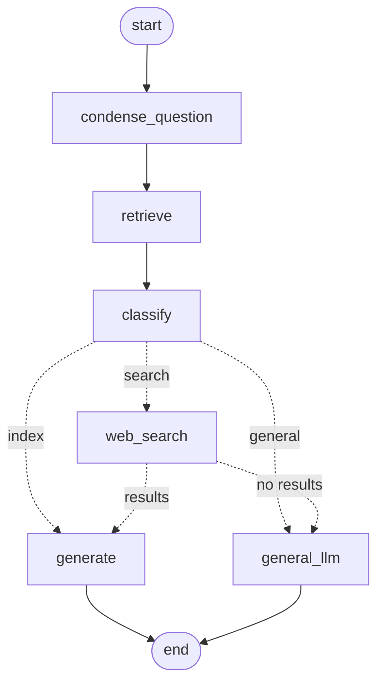

# Adaptive RAG Platform

A full-stack Retrieval-Augmented Generation (RAG) chatbot. Users sign in, upload PDF/TXT documents,
and ask questions. Each question is answered from the user's own documents, from general knowledge,
or from a web search, whichever fits.

## Architecture

```
Streamlit UI (:8501)
   │  signup / login                    chat (streamed) / conversations / documents
   ▼                                              │  Authorization: Bearer <jwt>
NestJS auth gateway (:8080)                       │
   • API token + JWT auth (Argon2id, SQLite)      │
   • /api/chat proxy (non-streaming) ─────────────┤
                                                  ▼
                                  FastAPI RAG service (:8000)
                                     • LangGraph pipeline: condense → retrieve → classify → answer
                                     • Per-user documents in Qdrant (embedded or server)
                                     • Web search (Tavily) and general-knowledge answers
                                     • Pluggable LLMs: Groq / OpenAI / Gemini / Anthropic
                                     • Conversations and document records in MongoDB
```

The gateway issues the JWT; the RAG service verifies it with the same `JWT_SECRET` and uses its subject
(the username) to keep each user's documents and conversations separate. Streamlit talks to the RAG
service directly for chat and uploads; the gateway's `/api/chat` is a simpler, non-streaming entry point
for other clients.

| Folder | Stack | Role |
|---|---|---|
| [`rag-service/`](rag-service/) | Python, FastAPI, LangGraph, LangChain, Qdrant, MongoDB, Streamlit | RAG service and web UI |
| [`auth-gateway/`](auth-gateway/) | TypeScript, NestJS, JWT, Argon2, SQLite | Auth gateway (Backend-For-Frontend) |

## How a question is answered



1. **condense_question** rewrites a follow-up ("what about the second one?") into a standalone question
   using the conversation history; skipped for the first message of a conversation.
2. **retrieve** fetches the user's most similar document chunks from Qdrant.
3. **classify** looks at the question and the retrieved chunks and picks a route: `index` (the chunks
   answer it), `general` (general knowledge) or `search` (needs fresh/external information).
4. **generate** answers from the chunks or web results and cites their sources; **general_llm** answers
   from the model's own knowledge. Web search falls back to general knowledge if it fails or
   `TAVILY_API_KEY` is not set.

## Highlights

- **Adaptive routing:** one classifier call decides whether the retrieved chunks are relevant and where else to look.
- **Conversations:** history is stored per user and conversation, follow-up questions are condensed, and the UI lists past chats.
- **Streaming answers:** the UI shows the answer as it is generated.
- **Persistent per-user documents:** chunks are stored in Qdrant tagged with user and document ids; documents survive restarts and can be deleted.
- **Provider-agnostic LLM layer:** switch between Groq, OpenAI, Gemini and Anthropic with one environment variable; embeddings can run locally for free (FastEmbed).
- **Layered auth:** expiring API tokens plus 1-day JWTs, with Argon2id password hashing.

## Quick start with Docker

Create `rag-service/.env` (below) and `auth-gateway/.env` (copy `auth-gateway/.env.example`); both must
have the same `JWT_SECRET`. Then:

```bash
docker compose up --build
```

This runs MongoDB, a Qdrant server, the RAG API, the auth gateway and Streamlit. Open
http://localhost:8501. Ports are bound to `127.0.0.1` and can be changed with `RAG_API_PORT`,
`GATEWAY_PORT` and `STREAMLIT_PORT`.

## Quick start (Windows, without Docker)

Prerequisites: Python 3.13 (used by the Docker image), Node.js 22, MongoDB running on
`localhost:27017`.

```powershell
# RAG service
cd rag-service
python -m venv venv
.\venv\Scripts\python.exe -m pip install -r requirements.txt
# create rag-service/.env (see below)

# Auth gateway
cd ..\auth-gateway
npm install
copy .env.example .env   # then set JWT_SECRET
npm run build

# Start everything (opens three PowerShell 7 / pwsh windows)
cd ..
.\start-all.ps1
```

Without `QDRANT_URL`, documents are stored by an embedded Qdrant in `rag-service/qdrant_data`, so no
vector database needs to be installed. Open http://localhost:8501, create an account, upload a document
and start chatting.

### `rag-service/.env`

```env
LLM_PROVIDER=groq            # groq | openai | gemini | anthropic
EMBEDDING_PROVIDER=local     # local | openai | gemini
GROQ_API_KEY=...             # key for the provider you chose
TAVILY_API_KEY=...           # optional; web search
JWT_SECRET=...               # required; same value as in auth-gateway/.env
```

See [`rag-service/README.md`](rag-service/README.md) for all options, and
[`auth-gateway/README.md`](auth-gateway/README.md) for the auth API.
