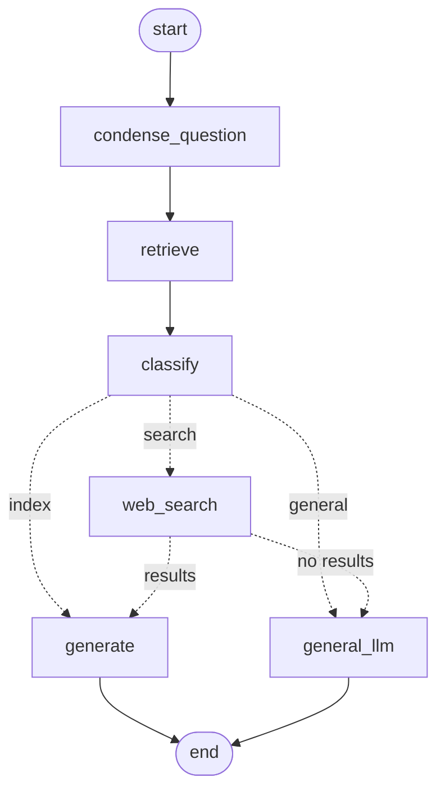

# Document Flow - Visual Guide

Diagrams of how documents and questions flow through the RAG service. The step-by-step explanation
is in [DOCUMENT_UPLOAD_FLOW.md](DOCUMENT_UPLOAD_FLOW.md).

## 🔄 How Documents Flow Through the System

### **Scenario 1: User Uploads a Document**

```
┌────────────────────────────────────────────┐
│  POST /rag/documents/upload                │
│  Authorization: Bearer <jwt>  (user alice) │
│  file: "Python_Guide.pdf"                  │
│  description: "Python tutorial"            │
└──────────────┬─────────────────────────────┘
               │
               ▼
        ┌──────────────────────────┐
        │  Check size              │
        │  ≤ MAX_UPLOAD_MB (413)   │
        └──────────┬───────────────┘
                   │
                   ▼
        ┌──────────────────────────┐
        │  Load PDF / TXT          │
        │  source = file name      │
        └──────────┬───────────────┘
                   │
                   ▼
        ┌──────────────────────────┐
        │  Split into chunks       │
        │  1000 chars, 150 overlap │
        │  e.g. 20 chunks          │
        └──────────┬───────────────┘
                   │
                   ▼
        ┌──────────────────────────────┐
        │  Tag each chunk              │
        │  user_id = alice             │
        │  doc_id  = 9a1b...           │
        │  Embed + store in Qdrant     │
        └──────────┬───────────────────┘
                   │
                   ▼
        ┌──────────────────────────────┐
        │  Save record in MongoDB      │
        │  (filename, description,     │
        │   chunks, uploaded_at)       │
        └──────────────────────────────┘
```

---

### **Scenario 2: User Asks a Question**



```
"What is Python?"  (conversation 3f2c..., user alice)
   │
   ▼  load last MAX_HISTORY_MESSAGES messages of the conversation
condense_question ── no history? keep the question as is
   │                 otherwise rewrite it to stand alone
   ▼
retrieve ─────────── Qdrant: top RETRIEVAL_K chunks where user_id = alice
   │
   ▼
classify ─────────── question + chunks →  index | general | search
   │
   ├─ index ───────→ generate     (answer from the chunks, cite sources)
   ├─ general ─────→ general_llm  (answer from general knowledge)
   └─ search ──────→ web_search ─→ generate     (answer from web results)
                     │
                     └─ no TAVILY_API_KEY, search failed or empty → general_llm
   │
   ▼
answer returned (or streamed), then question + answer saved to the conversation
```

---

### **Scenario 3: Upload a Second Document**

```
┌──────────────────────────────────────────┐
│ Qdrant collection "user_documents"       │
├──────────────────────────────────────────┤
│ alice / Python_Guide.pdf   (20 chunks)   │
│ alice / Web_Dev_Guide.pdf  (15 chunks)   │  ← new
│ bob   / Recipes.txt        (8 chunks)    │
└──────────────────────────────────────────┘

alice's questions search her 35 chunks; bob's chunks are filtered out.
```

---

### **Scenario 4: Delete a Document**

```
DELETE /rag/documents/9a1b...   (user alice)
   │
   ├─ record not found for alice → 404
   │
   ▼
Delete chunks in Qdrant where user_id = alice AND doc_id = 9a1b...
   │
   ▼
Delete the MongoDB record → {"status": "deleted"}
```

---

## 🔑 Key Takeaways

```
┌─────────────────────────────────────────────────────┐
│ 1. Upload:  load → split → tag → embed → Qdrant      │
│             + record in MongoDB                      │
│                                                      │
│ 2. Query:   condense → retrieve (own chunks only)    │
│             → classify → generate / general / web    │
│                                                      │
│ 3. Delete:  chunks and record removed                │
│                                                      │
│ Documents persist across restarts (embedded Qdrant   │
│ on disk, or a Qdrant server).                        │
└─────────────────────────────────────────────────────┘
```

---

## 🚀 Try It

1. **Start the system** (from `rag-service/`, with the auth gateway running)
   ```bash
   python -m uvicorn src.main:app --port 8000
   ```

2. **Upload a document** (with a JWT from the gateway's `/api/login`)
   ```bash
   curl -X POST http://localhost:8000/rag/documents/upload \
     -H "Authorization: Bearer $JWT" \
     -F "file=@my_file.pdf" \
     -F "description=My Document"
   ```

3. **Ask about it**
   ```bash
   curl -X POST http://localhost:8000/rag/query \
     -H "Authorization: Bearer $JWT" \
     -H "Content-Type: application/json" \
     -d '{"query": "Your question", "conversation_id": "test-1"}'
   ```
