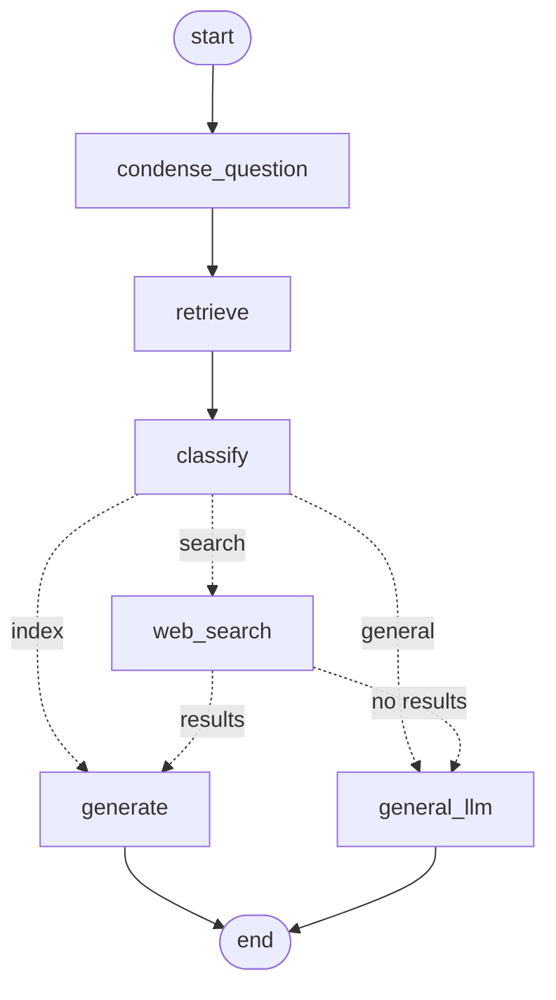

# Adaptive RAG - RAG Service

[](https://www.python.org/)
[](https://fastapi.tiangolo.com/)
[](https://langchain-ai.github.io/langgraph/)
[](https://qdrant.tech/)

## 📋 Overview

The RAG service is the FastAPI backend and Streamlit UI of Adaptive RAG. Each user uploads their own
PDF/TXT documents and chats with them in separate conversations. For every question a LangGraph
pipeline retrieves the user's relevant chunks and decides whether to answer from them, from general
knowledge, or from a web search.

Users sign up and log in through the [auth gateway](../auth-gateway/README.md); every RAG endpoint
requires the JWT it issues.

---

## 🎯 Key Features

### 🧠 Adaptive answering
- **Follow-up handling**: follow-up questions are rewritten into standalone questions using the conversation
- **One-step routing**: a classifier sees the question *and* the retrieved chunks and picks one route:
  - **index**: the user's documents answer it, so the answer is generated from them, with sources cited
  - **general**: answered from the model's general knowledge
  - **search**: needs real-time or external information, so the web is searched (Tavily)

### 📚 Documents
- PDF and TXT uploads, split into 1000-character chunks with 150 overlap
- Stored in Qdrant, one collection for all users, each chunk tagged with `user_id` and `doc_id`;
  searches only ever see the requesting user's chunks
- Persist across restarts; users can list and delete their documents

### 💬 Conversations
- Chat history in MongoDB, keyed by user and conversation id (chosen by the client)
- The most recent `MAX_HISTORY_MESSAGES` messages are sent to the model with each question
- Streaming answers (newline-delimited JSON)

### 🎨 Streamlit UI
- Login / signup page, then a chat page with a sidebar listing past conversations, a **New chat**
  button, document upload, and the user's documents with delete buttons

### 🔌 Pluggable models
- Chat model: Groq, OpenAI, Gemini or Anthropic; embeddings: local (FastEmbed), OpenAI or Gemini

---

## 🏗️ Architecture

### Graph



Defined in `src/rag/graph_builder.py`; prompts are in `src/config/prompts.yaml`.

### Graph Nodes

1. **condense_question**: rewrites the latest question into a standalone one using the conversation history (`condense_prompt`); no model call when there is no history
2. **retrieve**: fetches the user's `RETRIEVAL_K` most similar chunks from Qdrant
3. **classify**: picks `index`, `general` or `search` from the question and the retrieved chunks (`classify_prompt`); `index` is only possible when chunks were found
4. **generate**: answers from the context (document chunks or web results), citing sources (`generate_prompt`)
5. **general_llm**: answers from general knowledge, with the conversation as context
6. **web_search**: Tavily search (5 results) for the standalone question

Routing: `search` goes to `general_llm` instead when `TAVILY_API_KEY` is unset, and `web_search` falls
back to `general_llm` if the search fails or returns nothing. Only the output of `generate` and
`general_llm` is streamed to the user.

---

## 📦 Project Structure

```
rag-service/
├── src/
│   ├── main.py                    # FastAPI app; creates MongoDB indexes on startup
│   ├── api/
│   │   └── routes.py              # /rag endpoints
│   ├── config/
│   │   ├── settings.py            # Loads prompts.yaml
│   │   └── prompts.yaml           # condense / classify / generate prompts
│   ├── core/
│   │   ├── config.py              # Settings from environment variables
│   │   └── auth.py                # JWT verification (current_user dependency)
│   ├── db/
│   │   ├── mongo_client.py        # MongoDB client
│   │   └── documents.py           # Uploaded-document records
│   ├── llms/
│   │   └── provider.py            # Chat model and embeddings per provider
│   ├── memory/
│   │   └── chat_history_mongo.py  # Conversations in MongoDB
│   ├── models/
│   │   ├── state.py               # Graph state
│   │   ├── query_request.py       # Query request schema
│   │   └── route_identifier.py    # Classifier output
│   └── rag/
│       ├── graph_builder.py       # LangGraph pipeline
│       ├── retriever_setup.py     # Qdrant store: add, search, delete
│       └── document_upload.py     # PDF/TXT loading and chunking
├── streamlit_app/
│   ├── home.py                    # Login / signup
│   ├── pages/chat.py              # Chat, conversations, documents
│   └── utils/api_client.py        # Calls to the auth gateway and RAG API
├── Dockerfile                     # Image for the API and the Streamlit UI
└── requirements.txt
```

---

## 🔌 API Endpoints

Base URL: `http://localhost:8000`. Every `/rag` endpoint requires `Authorization: Bearer <jwt>` with a
JWT from the auth gateway's `/api/login`; a missing, invalid or expired token gets a 401. All data is
scoped to the user in the token.

| Method | Path | Purpose |
|---|---|---|
| POST | `/rag/query` | Answer a question, all at once |
| POST | `/rag/query/stream` | Answer a question, streamed |
| GET | `/rag/conversations` | The user's conversations |
| GET | `/rag/conversations/{conversation_id}/messages` | One conversation's messages |
| POST | `/rag/documents/upload` | Upload a document |
| GET | `/rag/documents` | The user's documents |
| DELETE | `/rag/documents/{doc_id}` | Delete a document |
| GET | `/` | Health check |

### Query

```http
POST /rag/query
Authorization: Bearer <jwt>
Content-Type: application/json

{"query": "What is the main topic of the document?", "conversation_id": "3f2c..."}
```

```json
{"result": {"type": "ai", "content": "Based on the document, the main topic is..."}}
```

- `query`: 1–10,000 characters
- `conversation_id`: 1–100 characters, chosen by the client (Streamlit uses a random hex id per chat).
  A new id starts a new conversation.
- The question and answer are saved to the conversation only once the answer succeeds. If the model
  call fails the response is a 502.

### Streaming query

`POST /rag/query/stream` takes the same body and returns `application/x-ndjson`, one JSON event per line:

```
{"type": "token", "content": "Based on"}
{"type": "token", "content": " the document..."}
{"type": "done"}
```

On failure the stream ends with `{"type": "error", "message": "..."}` instead of `done`, and nothing is saved.

### Conversations

`GET /rag/conversations` returns up to 50 conversations, most recently active first:

```json
[{"conversation_id": "3f2c...", "title": "What is the main topic...", "updated_at": "2026-10-26T10:00:00Z"}]
```

The title is the conversation's first question. `GET /rag/conversations/{conversation_id}/messages`
returns `[{"role": "human" | "ai", "content": "..."}]`, oldest first.

### Document upload

```http
POST /rag/documents/upload
Authorization: Bearer <jwt>
Content-Type: multipart/form-data

file=<PDF or TXT file>
description=Brief description of the document
```

```json
{
  "status": true,
  "document": {
    "doc_id": "9a1b...", "user_id": "alice", "filename": "guide.pdf",
    "description": "Brief description of the document", "chunks": 20,
    "uploaded_at": "2026-10-26T10:00:00Z"
  }
}
```

- `description` is a form field (1–300 characters) and is required. It is stored with the document
  record and shown in the UI; it is not used for retrieval.
- Only `.pdf` and `.txt` files are accepted (400 otherwise, or if no text can be extracted).
- Files larger than `MAX_UPLOAD_MB` get a 413. If storing the chunks fails the response is a 502.

### Documents

`GET /rag/documents` returns the user's document records (as above, without `status`), newest first.
`DELETE /rag/documents/{doc_id}` removes the document's chunks and record and returns
`{"status": "deleted"}`, or 404 if the user has no such document.

---

## 📖 Usage Guide

### 1. Prerequisites

- Python 3.13 (used by the Docker image)
- MongoDB (default `mongodb://localhost:27017`)
- An API key for the chat model provider you choose
- Optional: a Tavily API key for web search, and a Qdrant server (by default Qdrant runs embedded, see
  [QDRANT_SETUP_GUIDE.md](QDRANT_SETUP_GUIDE.md))
- The [auth gateway](../auth-gateway/README.md) running, for logins

### 2. Installation

```bash
cd rag-service
python -m venv venv
source venv/bin/activate  # On Windows: venv\Scripts\activate
pip install -r requirements.txt
```

### 3. Environment Configuration

Create `rag-service/.env`. Only the API keys for the providers you pick are needed.

```env
# Required: verifies login tokens; must equal JWT_SECRET in auth-gateway/.env
JWT_SECRET=...

# Chat model: groq | openai | gemini | anthropic
LLM_PROVIDER=groq
# LLM_MODEL=            # optional override of the provider default

# Embeddings: local (free, runs on CPU) | openai | gemini
# Groq and Anthropic have no embeddings API, so pair them with "local".
EMBEDDING_PROVIDER=local
# EMBEDDING_MODEL=

GROQ_API_KEY=...        # https://console.groq.com/keys
# OPENAI_API_KEY=...
# GOOGLE_API_KEY=...    # Gemini
# ANTHROPIC_API_KEY=...

# Optional: web search; without it "search" questions are answered from general knowledge
TAVILY_API_KEY=...
```

| Provider    | Default model           | Embeddings            |
|-------------|-------------------------|-----------------------|
| `groq`      | `openai/gpt-oss-120b`   | use `local`           |
| `openai`    | `gpt-4o`                | `text-embedding-3-small` |
| `gemini`    | `gemini-2.5-flash`      | `models/gemini-embedding-001` |
| `anthropic` | `claude-opus-5-5`       | use `local`           |
| `local` (embeddings only) | -         | `BAAI/bge-small-en-v1.5` (downloaded on first run) |

Other settings (all optional):

| Variable | Default | Purpose |
|---|---|---|
| `MONGO_URL` | `mongodb://localhost:27017` | MongoDB for conversations and document records |
| `MONGO_DB` | `adaptive_rag` | Database name |
| `QDRANT_URL` | empty | Qdrant server; when empty, Qdrant runs embedded |
| `QDRANT_API_KEY` | empty | API key for the Qdrant server (e.g. Qdrant Cloud) |
| `QDRANT_PATH` | `qdrant_data` | Embedded Qdrant's data folder, relative to the working directory |
| `QDRANT_COLLECTION` | `user_documents` | Collection holding all users' chunks |
| `RETRIEVAL_K` | `4` | Chunks retrieved per question |
| `MAX_HISTORY_MESSAGES` | `20` | Most recent messages sent to the model with each question |
| `MAX_UPLOAD_MB` | `10` | Upload size limit |

The Streamlit app reads `AUTH_GATEWAY_URL` (default `http://localhost:8080/api`) and `RAG_API_URL`
(default `http://127.0.0.1:8000`).

### 4. Running the Application

Run these from `rag-service/` (so the embedded Qdrant data lands in `rag-service/qdrant_data`):

```bash
# Terminal 1: RAG API
python -m uvicorn src.main:app --port 8000

# Terminal 2: Streamlit UI
python -m streamlit run streamlit_app/home.py
```

Or start the API, gateway and UI together with `start-all.ps1` in the repository root, or run the whole
stack (including MongoDB and a Qdrant server) with `docker compose up --build`.

- Web interface: http://localhost:8501
- API documentation: http://localhost:8000/docs

### 5. Example Usage

**Web interface:** open http://localhost:8501, create an account and log in, upload documents in the
sidebar, and chat. Use **New chat** to start a conversation and the sidebar list to reopen old ones.

**cURL:**
```bash
# Log in through the auth gateway
API_TOKEN=$(curl -s -X POST http://localhost:8080/api/init | jq -r .api_token)
JWT=$(curl -s -X POST http://localhost:8080/api/login \
  -H "X-API-TOKEN: $API_TOKEN" -H "Content-Type: application/json" \
  -d '{"username": "alice", "password": "..."}' | jq -r .jwt)

# Upload a document
curl -X POST http://localhost:8000/rag/documents/upload \
  -H "Authorization: Bearer $JWT" \
  -F "file=@document.pdf" \
  -F "description=Sample document about Python"

# Ask a question
curl -X POST http://localhost:8000/rag/query \
  -H "Authorization: Bearer $JWT" \
  -H "Content-Type: application/json" \
  -d '{"query": "Tell me about Python", "conversation_id": "my-first-chat"}'
```

**Python (streaming):**
```python
import json
import requests

with requests.post(
    "http://localhost:8000/rag/query/stream",
    headers={"Authorization": f"Bearer {jwt}"},
    json={"query": "What is Python?", "conversation_id": "my-first-chat"},
    stream=True,
) as response:
    for line in response.iter_lines(decode_unicode=True):
        if line:
            event = json.loads(line)
            if event["type"] == "token":
                print(event["content"], end="", flush=True)
```

---

## 🧪 Trying the API

You can try the endpoints interactively at http://localhost:8000/docs; fill in each endpoint's
`authorization` header field with `Bearer <jwt>`.

---

## 🔐 Security Considerations

- Keep API keys and `JWT_SECRET` in `.env` (git-ignored); never commit them
- Use a long random `JWT_SECRET`, identical in both services
- Every `/rag` endpoint checks the JWT, and documents and conversations are scoped to its user
- Docker Compose binds ports to `127.0.0.1`; put a reverse proxy with HTTPS in front for remote access
- Secure MongoDB and Qdrant with credentials when they are reachable from outside

---

## 🚀 Deployment

### Docker Compose

From the repository root:

```bash
docker compose up --build
```

The `rag-service` image (`Dockerfile`) runs the API by default; Compose also uses it for the Streamlit
service. Compose reads `rag-service/.env` and `auth-gateway/.env`, points the API at its MongoDB and
Qdrant containers (`MONGO_URL`, `QDRANT_URL`), and keeps data in named volumes (MongoDB, Qdrant,
downloaded embedding models, gateway users). Host ports default to 8000/8080/8501 and can be changed
with `RAG_API_PORT`, `GATEWAY_PORT` and `STREAMLIT_PORT`.

### Without Docker

```bash
python -m uvicorn src.main:app --host 0.0.0.0 --port 8000
```

With embedded Qdrant only one process can open `QDRANT_PATH`, so run a single worker, or set
`QDRANT_URL` to a Qdrant server before scaling out.

---

## 📚 Technology Stack

| Component | Technology | Version |
|-----------|-----------|---------|
| **Workflow Orchestration** | LangGraph | 0.5.4 |
| **LLM Framework** | LangChain core / community | 0.3.86 / 0.3.31 |
| **Web Framework** | FastAPI + Uvicorn | 0.162.0 / 0.54.0 |
| **UI Framework** | Streamlit | 1.66.1 |
| **Vector Database** | Qdrant (`qdrant-client`, `langchain-qdrant`) | 1.20.0 / 0.2.1 |
| **Chat & Document Records** | MongoDB via Motor | 3.7.1 |
| **Local Embeddings** | FastEmbed | 0.9.1 |
| **Web Search** | Tavily (`langchain-tavily`) | 0.2.17 |
| **LLM Providers** | `langchain-groq` / `-openai` / `-anthropic` / `-google-genai` | see `requirements.txt` |
| **Auth** | PyJWT | 2.15.1 |
| **Data Validation** | Pydantic | 2.11.10 |

---

## 📝 Documentation References

- [DOCUMENT_UPLOAD_FLOW.md](DOCUMENT_UPLOAD_FLOW.md) - How uploads are stored, searched and deleted
- [DOCUMENT_FLOW_VISUAL.md](DOCUMENT_FLOW_VISUAL.md) - The same flows as diagrams
- [QDRANT_SETUP_GUIDE.md](QDRANT_SETUP_GUIDE.md) - Embedded Qdrant, Docker, and Qdrant Cloud
- [CODE_STYLE_GUIDE.md](CODE_STYLE_GUIDE.md) - Coding standards
- [QUICK_REFERENCE.md](QUICK_REFERENCE.md) - Quick patterns and templates
- [DOCUMENTATION_INDEX.md](DOCUMENTATION_INDEX.md) - Documentation index

---

## ❓ FAQ

**Q: How do I upload multiple documents?**
A: Upload them one at a time. All of a user's documents are searched together.

**Q: What's the maximum file size?**
A: `MAX_UPLOAD_MB`, 10 MB by default.

**Q: Do documents survive a restart?**
A: Yes. Chunks are stored in Qdrant (on disk in `QDRANT_PATH`, or in the Qdrant server) and document
records in MongoDB.

**Q: Can I use different LLM providers?**
A: Yes, set `LLM_PROVIDER` (and optionally `LLM_MODEL`) plus that provider's API key. See `src/llms/provider.py`.

**Q: I changed the embedding model and now uploads fail.**
A: The existing collection was created with the old model's vector size. Set a new `QDRANT_COLLECTION`
(or delete the old collection) and upload the documents again.

**Q: How is conversation history stored?**
A: In MongoDB's `chat_history` collection, one record per message, keyed by `user_id` and `conversation_id`.

**Q: Can I run this without web search?**
A: Yes. Leave `TAVILY_API_KEY` unset; questions classified as `search` are answered from general knowledge.

---

## 👤 Author

**Rizwan Saifi**
- GitHub: [@Rizwan-saifi](https://github.com/Rizwan-saifi)
- Project: [Adaptive RAG](https://github.com/Rizwan-saifi/adaptive-rag)
